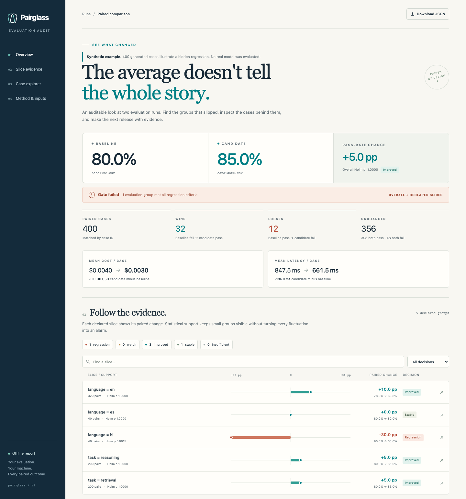

# Pairglass

[](https://github.com/pralav-25/pairglass/actions/workflows/ci.yml)
[](pyproject.toml)
[](LICENSE)

**Your model improved. Who did it get worse for?**

Compare two evaluation CSVs by case ID. Find subgroup regressions hidden by an improving overall score, inspect the exact lost cases, and export a report that works offline.

[Explore the synthetic demo](https://pralav-25.github.io/pairglass/) · [How the statistics work](docs/methodology.md) · [Contribute](CONTRIBUTING.md)



## A better average can hide a worse experience

The included **synthetic** example has 400 paired evaluations:

| Group | Pairs | Baseline | Candidate | Change |
| --- | ---: | ---: | ---: | ---: |
| Overall | 400 | 80.00% | 85.00% | +5.00 pp |
| `language=en` | 320 | 78.75% | 88.75% | +10.00 pp |
| `language=hi` | 40 | 90.00% | 60.00% | **−30.00 pp** |
| `language=es` | 40 | 80.00% | 80.00% | 0.00 pp |
| `task=reasoning` | 200 | 80.00% | 85.00% | +5.00 pp |
| `task=retrieval` | 200 | 80.00% | 85.00% | +5.00 pp |

Language and task rows are separate marginal slices and overlap.

For `language=hi`, 12 cases change from pass to fail and none change from fail to pass. Its one-sided exact paired p-value is `0.000244`; Holm adjustment across the six eligible overall, language and task comparisons gives `0.001465`. The default gate catches this regression even though the overall score improves.

These numbers demonstrate the workflow. They are not a benchmark of a real model.

## Try it in one minute

Requires Python 3.10 or later. Pairglass has **no runtime dependencies** and makes no network requests during comparison or report viewing.

```sh
git clone https://github.com/pralav-25/pairglass.git
cd pairglass
python -m pip install .
pairglass demo --output report.html
```

Open `report.html` in your browser. Search the paired cases, filter slices, inspect losses and download the report data as JSON. Everything is in one HTML file; no server, account or API key is required.

The Python distribution is named `pairglass-eval`; the import and command are `pairglass`. Install from this checkout for now. A PyPI release has not been published.

If your Python executable is named `python3`, use that in place of `python` in these commands.

## Compare your own results

```sh
pairglass compare baseline.csv candidate.csv \
  --slice language --slice task \
  --output report.html \
  --json report.json \
  --markdown report.md \
  --losses losses.csv \
  --fail-on-regression
```

Pairglass joins by `id`, so row order may differ. Both files must contain exactly the same IDs, each once, and the selected slice values must match for every paired case. Header names and IDs are trimmed; `passed` tokens are trimmed and case-insensitive. Slice values are preserved exactly, and a blank slice value is an explicit category.

Minimal input:

```csv
id,passed,language,task
case-001,1,en,retrieval
case-002,0,hi,reasoning
```

Full input can include:

```csv
id,passed,language,task,cost_usd,latency_ms,note
case-001,1,en,retrieval,0.002,120,Answer contains the expected fact
case-002,0,hi,reasoning,0.003,180,Incorrect final answer
```

| Column | Contract |
| --- | --- |
| `id` | Required, nonempty and unique in each file; exact ID sets must match |
| `passed` | Required binary outcome: `0`/`1`, `true`/`false` or `pass`/`fail` |
| Slice columns | Declare with `--slice`; values must agree between baseline and candidate |
| `cost_usd`, `latency_ms` | Optional; a metric must appear in both headers, with complete, numeric, finite and nonnegative values |
| `note` | Optional case context for review |

Use the same evaluation cases, ground truth and grading rule in both runs. Pairglass audits existing pass/fail results; it does not run a model or judge an answer.

## A transparent regression gate

The default policy flags a group only when **all three** conditions hold:

- At least **20** paired cases.
- Accuracy drops by at least **5 percentage points**.
- The **Holm-adjusted one-sided paired p-value is at most 0.05**.

The correction includes overall and every support-eligible value of every declared slice, including groups that improve. Slice columns are analyzed separately; Pairglass does not search arbitrary intersections or invent subgroups.

Tune the policy for your use case:

```sh
pairglass compare baseline.csv candidate.csv \
  --slice language --min-pairs 40 --max-drop 0.03 --alpha 0.01 \
  --output report.html --fail-on-regression
```

`--max-drop` is an absolute proportion: `0.03` means 3 percentage points. Cost and latency are descriptive summaries; they do not participate in the regression gate.

| Exit code | Meaning |
| --- | --- |
| `0` | Comparison completed; with `--fail-on-regression`, no group met the regression rule |
| `1` | A group met the regression rule and `--fail-on-regression` was supplied |
| `2` | Input, configuration or output error |

Reports are written for valid comparisons, including those that fail the gate. See the [methodology](docs/methodology.md) for the formula, multiple-testing family and interpretation limits.

## Use it from Python

```python
from pathlib import Path
from pairglass import compare, render_html

report = compare("baseline.csv", "candidate.csv", slices=["language"])
Path("report.html").write_text(render_html(report), encoding="utf-8")
```

## Keep an audit in CI

After your evaluation pipeline produces both CSVs, add the action:

```yaml
- uses: pralav-25/pairglass@v0.1.0
  with:
    baseline: baseline.csv
    candidate: candidate.csv
    slices: language,task
```

See the [GitHub Actions guide](docs/github-actions.md) for a full workflow, Python setup and report retention. Preserve the reports as CI artifacts even when the audit exits `1`, so reviewers can inspect the reason for the failure. The CLI's `--fail-on-regression` also works in other CI systems.

## Scope

Pairglass focuses on two runs of binary case outcomes. It uses a one-sided exact binomial test on pass/fail transitions, equivalent to the directional exact McNemar formulation, then Holm adjustment. These are established statistical methods.

The workflow assumes independent evaluation cases. Repeated generations from one prompt, shared users or documents, and other clustered data need different uncertainty methods. A passing gate does not establish equivalence or rule out meaningful harm. Small groups remain visible but are excluded from inference below the support threshold.

Inputs are limited to 100,000 rows and 20 MiB per file, with at most 100 declared slice-value groups plus overall. CSVs must use UTF-8. Continuous-score tests, clustered inference and automatic subgroup discovery are outside the current release.

Existing tools already provide evaluation, subgroup analysis and statistical comparisons. Pairglass packages a narrower workflow: strict CSV pairing, case transitions, explicit policy and a portable report. See [the project research](docs/research.md).

## Development

```sh
python -m pip install -e .
python -m unittest discover -s tests
python scripts/verify_demo.py
```

Small contributions with reproducible examples are welcome. Read [CONTRIBUTING.md](CONTRIBUTING.md) before changing statistical behavior.

## License

[MIT](LICENSE).
